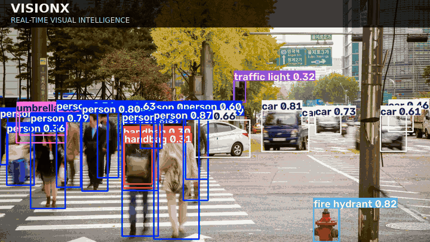

# VisionX — Real-Time Visual Intelligence

<p align="center">
  
</p>

<p align="center">
  <strong>Object detection · Multi-object tracking · Hardware-aware computer vision</strong><br />
  An experimental computer vision system exploring how vision pipelines behave on everyday consumer hardware.
</p>

## Overview

VisionX combines Ultralytics YOLO11n, OpenVINO, ByteTrack, and a Streamlit interface for image detection, video processing, webcam inference, and backend comparison.

**Engineering question:** What changes when multi-object tracking is added to an object-detection pipeline running on consumer hardware?

The project measures processing latency and throughput and records track-level signals. Speed measurements and detection counts are not evidence of model accuracy.

## Features

- Image detection with annotated output
- Video and browser-webcam workflows
- PyTorch CPU, OpenVINO CPU, and OpenVINO Intel GPU backends
- Adjustable confidence threshold and inference resolution
- Optional object tracking with track IDs
- Inference benchmark and tracking-comparison scripts
- Interactive Streamlit interface

## Technology stack

Python · Ultralytics YOLO11n · PyTorch · OpenVINO · OpenCV · ByteTrack · Streamlit · Pandas

## Quick start

See **[docs/SETUP.md](docs/SETUP.md)** for complete Windows setup, model preparation, sample-image download, tests, and troubleshooting.

```powershell
git clone https://github.com/gradientvb/VisionX.git
cd VisionX
py -3.13 -m venv .venv
.\.venv\Scripts\python.exe -m pip install --upgrade pip
.\.venv\Scripts\python.exe -m pip install -r .\requirement.txt
```

Download the pretrained YOLO11n checkpoint and export the OpenVINO model:

```powershell
.\.venv\Scripts\python.exe -c "from ultralytics import YOLO; YOLO('yolo11n.pt')"
.\.venv\Scripts\python.exe -c "from ultralytics import YOLO; YOLO('yolo11n.pt').export(format='openvino')"
.\.venv\Scripts\python.exe -m streamlit run app.py
```

## Inference backends

| Backend | Execution target | Notes |
|---|---|---|
| PyTorch CPU | CPU | Baseline runtime |
| OpenVINO CPU | CPU | Optimized inference runtime |
| OpenVINO Intel GPU | Compatible Intel GPU | Requires supported hardware, drivers, and OpenVINO device support |

The Intel GPU backend is not CUDA and does not require an NVIDIA GPU. If an Intel GPU device is unavailable, begin with a CPU backend.

## Sample image inference

Download the sample image set from the project root, then run a detection:

```powershell
.\download_visionx_test_data.ps1
.\.venv\Scripts\python.exe .\scripts\run_image.py .\assets\sample_images\000000179765.jpg --backend pytorch_cpu --size 640 --confidence 0.25
```

Annotated output is written under **experiments/results/**. Sample images are not committed to the repository; see the setup guide.

## Initial inference comparison

An initial local experiment processed 21 images at three input resolutions. These measurements are preliminary, not a general performance guarantee.

| Backend | Input size | Mean latency | Reciprocal latency (estimated FPS) |
|---|---:|---:|---:|
| PyTorch CPU | 320 | 50.64 ms | 19.75 |
| PyTorch CPU | 480 | 79.37 ms | 12.60 |
| PyTorch CPU | 640 | 93.19 ms | 10.73 |
| OpenVINO CPU | 320 | 40.06 ms | 24.96 |
| OpenVINO CPU | 480 | 38.12 ms | 26.23 |
| OpenVINO CPU | 640 | 39.47 ms | 25.34 |
| OpenVINO Intel GPU | 320 | 35.38 ms | 28.26 |
| OpenVINO Intel GPU | 480 | 37.08 ms | 26.97 |
| OpenVINO Intel GPU | 640 | 37.67 ms | 26.54 |

In this sample, OpenVINO had lower measured per-image latency than the PyTorch CPU baseline. The image set was small and is not representative of all scenes. FPS here is the reciprocal of single-image latency, **not sustained video-stream throughput**. Results can vary with hardware load, runtime versions, warm-up, and image content.

## Detection versus tracking

The script `scripts/compare_tracking.py` compares detection with tracking disabled against ByteTrack-enabled processing on the same video.

```powershell
.\.venv\Scripts\python.exe .\scripts\compare_tracking.py --video .\path\to\your_video.mp4 --backend pytorch_cpu --size 640 --confidence 0.25 --runs 5 --warmup-frames 20
```

Provide your own local video file; videos are not included. The script records latency percentiles, processing throughput, per-frame detection counts, unique track IDs, and a track-label majority-fraction proxy. It measures model inference plus result plotting and excludes video decoding, so its throughput is not end-to-end application FPS.

**Metric limitations**
- Detection counts are not precision, recall, or mAP.
- The track-label majority fraction is a consistency proxy, not proof of correct identities.
- Ground-truth annotations and suitable metrics are required for accuracy or tracking-quality claims.

**Working research question:** How does adding multi-object tracking affect processing performance and track-level label consistency in a real-time object detection pipeline on consumer hardware?

For detailed benchmark procedures, output files, and metric limitations, see **[docs/EXPERIMENTS.md](docs/EXPERIMENTS.md)**.

## Tests

```powershell
.\.venv\Scripts\python.exe -m unittest discover -s tests -p "test_*.py"
```

## Repository structure

```text
VisionX/
├── app.py
├── requirement.txt
├── download_visionx_test_data.ps1
├── docs/
│   └── SETUP.md
├── scripts/
│   ├── benchmark.py
│   ├── compare_tracking.py
│   ├── run_image.py
│   └── test_gpu.py
├── src/visionx/
│   └── detector.py
├── tests/
│   └── test_detector.py
└── assets/
    └── visionx_demo.gif
```

Model weights, exported OpenVINO artifacts, downloaded images, local videos, and generated experiment outputs are excluded from Git.

## Roadmap

- [x] Streamlit image, video, and webcam interface
- [x] Selectable inference backends
- [x] ByteTrack integration
- [x] Initial inference and tracking comparison scripts
- [x] Windows setup and reproducibility guide
- [ ] Expand automated tests and error handling
- [ ] Add curated experiment reports and plots
- [ ] Evaluate on a representative, documented video set
- [ ] Add ground-truth-based detection and tracking evaluation

## Author

**Vaibhav Bhardwaj**  
Computer Science & Data Science · Computer Vision · AI Systems

- GitHub: [gradientvb](https://github.com/gradientvb)
- LinkedIn: [Vaibhav Bhardwaj](https://www.linkedin.com/in/vaibhav-bhardwaj-955229295/)

---

<p align="center">
  <strong>VisionX — From object detection to visual intelligence.</strong><br />
  Built to experiment. Measured with care. Improved with evidence.
</p>
